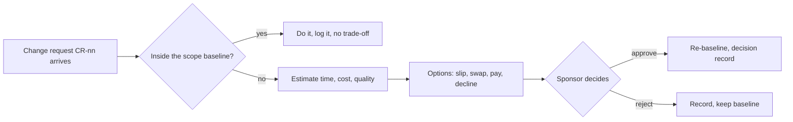

# Change requests · Realtime Quiz · trade-off analysis
Capacity 40 h/week · contingency 56 h · paid capacity 12 USD/h

## CR-01 · Add chat (F14, 40 h) to the Must scope · requested by sponsor

| Option | Time impact | Cost impact | Quality impact | Fixed side? |
|--------|-------------|-------------|----------------|-------------|
| A slip the pilot | +1 week (40/40) | 0 USD | Full scope delivered with chat, but pilot is delayed to week 15, missing the semester deadline and violating the milestone schedule. | violates C-01 |
| B swap: defer F16 (30 h) and F12 (12 h) | +0 weeks | 0 USD (-2 h net effort) | Delivers in-session chat (F14) in pilot; instructors lose shared question bank (F16, 30 h) and automated toast notifications (F12, 12 h), relying on verbal prompts and manual question entry; core WebSocket latency (< 500 ms) preserved. | ok |
| C pay: TA 40 h | +0 weeks | 40 x 12 = 480 USD | Delivers full scope including chat without sacrificing any features, but external labour spend exceeds the department cash budget by 280 USD. | violates C-03 |
| D decline the request | +0 weeks | 0 USD | Chat remains in Could scope for post-pilot release; protects the 56 h contingency buffer and avoids adding chat message load to the real-time WebSocket broadcast (< 500 ms NFR). | ok |

**Recommendation:** B (swap). Deferring F16 (30 h) and F12 (12 h) frees 42 h, absorbing the 40 h chat feature with a 2 h safety margin while preserving the week-14 pilot deadline and zero cash expenditure. Option A is rejected because slipping the pilot past week 14 violates the non-negotiable semester deadline (violates C-01). Option C is rejected because 480 USD exceeds the total 200 USD cash budget (violates C-03). Option D is rejected because chat is a high-visibility sponsor priority that can be accommodated cleanly by trading non-critical Should/Could scope.

## CR-02 · Anonymous joining (F15, 12 h) · requested by students

| Option | Time impact | Cost impact | Quality impact | Fixed side? |
|--------|-------------|-------------|----------------|-------------|
| A slip the pilot | +0.3 weeks (12/40) | 0 USD | Anonymous joining delivered, but slips delivery by 1.5 working days, compressing load testing (week 12) and pilot staging buffer. | violates C-01 |
| B swap: defer F12 (12 h) | +0 weeks | 0 USD (12 h swapped) | Students join informally using guest nicknames (F15), but instructors lose real-time in-app notification toasts (F12) and must announce quiz events verbally. | ok |
| C pay: TA 12 h | +0 weeks | 12 x 12 = 144 USD | Full scope delivered without cuts, but spending 144 USD consumes 72% of the 200 USD cash budget, leaving insufficient funds for hosting (100 USD) and domain (15 USD). | violates C-03 |
| D decline the request | +0 weeks | 0 USD | Scope baseline remains stable; students authenticate using standard student credentials (F06, Must), ensuring grading integrity, audit logging, and avoiding guest abuse. | ok |

**Recommendation:** D (decline). Standard authentication (F06, Must) already enables full student participation with verified identities, avoiding the grading integrity and moderation risks of guest nicknames. Option A is rejected because any delay to the week-14 pilot violates C-01. Option B is rejected because sacrificing real-time notifications (F12) degrades instructor classroom usability for an unessential student convenience. Option C is rejected because spending 144 USD on student labor violates C-03 by exhausting necessary infrastructure cash reserves.

## CR-03 · Semester shortened by 2 weeks: pilot in week 12 · dean
Capacity lost: 2 weeks x 40 h = 80 h; contingency lost: 8 h (contingency shrinks 56 -> 48 h, 10 % of 480 h)
Planned work 504 h now exceeds capacity 480 h by 24 h before any risk.

| Option | Time impact | Cost impact | Quality impact | Fixed side? |
|--------|-------------|-------------|----------------|-------------|
| A keep all Should, drop Could (F14 40 + F15 12 + F16 30 + F17 12 = 94 h) | +0 weeks | 0 USD (-94 h scope; fits with 70 h buffer) | Must scope intact (300 h) and Should scope intact (110 h); dropped features: no chat (F14), no anonymous joining (F15), no question bank (F16), and no admin user management UI (F17). | ok |
| B keep scope, pay TA 104 h | +0 weeks | 104 x 12 = 1248 USD | All 504 h planned scope delivered on week 12, but external labour spend of 1,248 USD exceeds the entire project cash budget six-fold. | violates C-03 |
| C keep scope, pilot week 14 | +2 weeks | 0 USD | Preserves full 504 h scope, but delivers in week 14, ignoring the dean's revised academic semester schedule. | violates new C-01 (dean) |

**Recommendation:** A. It restores a buffer (70 h) larger than the original contingency and touches no Must feature; B breaks the cash budget (exceeds 200 USD by 1,048 USD, violating C-03); C ignores the dean's constraint (violates week-12 pilot date).

## Process

