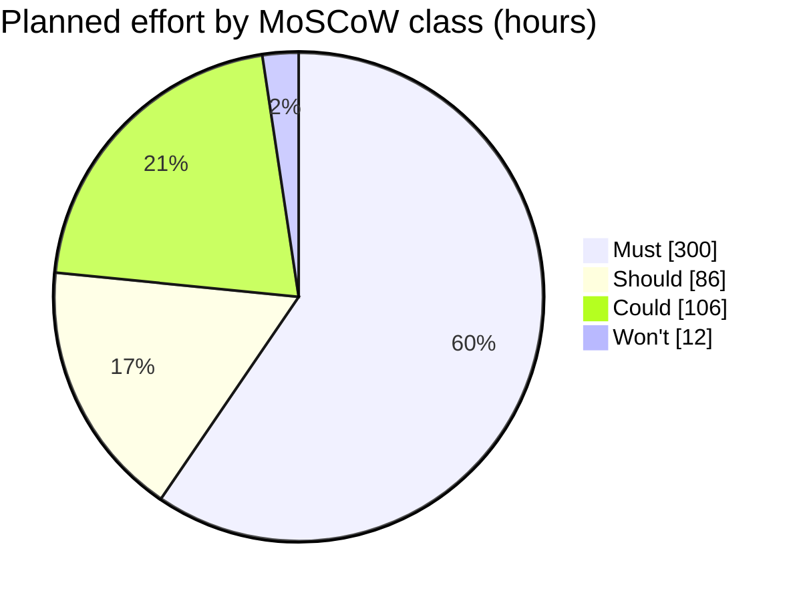

# MoSCoW rating for the week-14 pilot · Realtime Quiz

Test order: Must = pilot cancelled without it; Should = painful but a workaround exists; Could = nice to have; Won't = not in this pilot.

| Id  | Feature | Plan | Mine | h | Justification |
|-----|---------|------|------|---|---------------|
| F01 | Create quizzes with multiple-choice questions | Must | Must | 44 | Must: without quiz creation and question authoring, no quizzes exist and the pilot is cancelled. |
| F02 | Students participate in real time | Must | Must | 52 | Must: real-time student participation is the core purpose of the project; without it the pilot is cancelled. |
| F03 | Instant feedback and scoring | Must | Must | 28 | Must: without automated real-time scoring and instant feedback, the evaluation workflow is broken and the pilot is cancelled. |
| F04 | Leaderboards | Must | Must | 24 | Must: live rankings provide the core competitive motivation; without them the pilot session is cancelled. |
| F05 | Real-time updates over WebSocket | Must | Must | 48 | Must: fundamental technical dependency required by F02 and F04; without low-latency WebSocket broadcasting the pilot is cancelled. |
| F06 | Authentication and roles | Must | Must | 44 | Must: role separation between instructors and students is mandatory; without it session control and grading integrity fail. |
| F07 | Timer per question | Must | Must | 28 | Must: synchronized question timers keep all 50 participants aligned; without timers the live pilot is cancelled. |
| F08 | Multiple concurrent sessions | Must | Must | 32 | Must: required to isolate separate quiz rooms and test groups without mutual interference during the pilot. |
| F09 | Responsive design | Should | Should | 20 | Should: painful across mobile screens, but students can use laptops or standard browser zoom as a pilot workaround. |
| F10 | Analytics and reporting | Should | Should | 30 | Should: instructors need performance statistics, but inspecting raw score exports in a spreadsheet serves as a viable workaround. |
| F11 | Export results to CSV and PDF | Should | Should | 24 | Should: instructors can open the CSV in spreadsheet software; formatted PDF generation is cosmetic and can wait. |
| F12 | Real-time notifications | Should | Should | 12 | Should: notification banners improve UX, but verbal cues from the instructor in the room provide an acceptable workaround. |
| F13 | Multimedia in questions | Should | Could | 24 | Could: pilot quizzes will use text-only questions agreed with instructors, deferring image and audio uploads to release 1.1. |
| F14 | Chat during sessions | Could | Could | 40 | Could: nice to have for casual interaction, but existing classroom communication or raising hands serves as an easy workaround. |
| F15 | Anonymous joining with nickname | Could | Could | 12 | Could: nicknames are fun for informal quizzes, but formal student authentication (F06) is already available and required. |
| F16 | Question bank shared between quizzes | Could | Could | 30 | Could: shared question pools reduce preparation time, but instructors can copy-paste questions across quizzes for the pilot. |
| F17 | Admin role and user management | Could | Won't | 12 | Won't: explicitly excluded from this pilot; the PM will batch-provision the 50 pilot accounts using database SQL scripts. |

## Totals

| Class  | Features | Hours | Share of 504 h |
|--------|----------|-------|----------------|
| Must   | 8        | 300   | 59.5 %         |
| Should | 4        | 86    | 17.1 %         |
| Could  | 4        | 106   | 21.0 %         |
| Won't  | 1        | 12    | 2.4 %          |

Must share = 300 h / 504 h x 100 = 59.5 % (inside the 60 % guideline)

