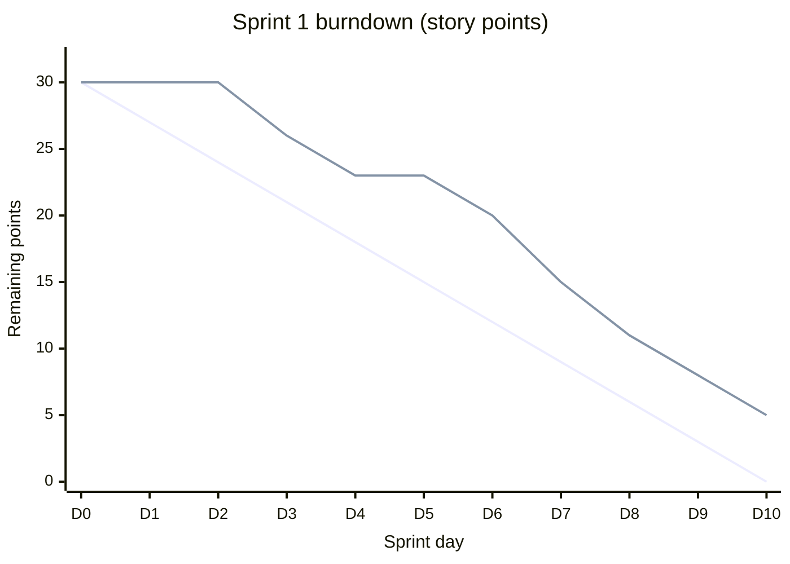

# Sprint 1 Planning & Burndown Analysis · Realtime Quiz

**Date & Time:** Tuesday 2026-10-20, 10:00  
**Facilitator:** Scrum Master (Student B)  
**Attendees:** Student A (Product Owner / Developer), Student B (Scrum Master / Developer), Student C (Developer), Student D (Developer)  
**Context:** Sprint 1 of 4 delivery sprints in the 14-week hybrid life cycle (Weeks 4–5: 2026-10-20 to 2026-11-02).

---

## 1. Planning Poker Session

The team estimated the seven initial "Must" items from the product backlog using Planning Poker with standard Fibonacci values (1, 2, 3, 5, 8, 13, 21).

### Planning Poker Estimation Table

| Item | Description | A | B | C | D | Agreed | Note |
| :--- | :--- | :-: | :-: | :-: | :-: | :---: | :--- |
| **B-01** | Project skeleton, CI, Docker, Flyway | 3 | 3 | 5 | 2 | **3** | Re-estimated: C (5) and D (2) were >1 step apart; agreed on 3 after debate on CI/migration complexity. |
| **B-02** | Register with email, name, role | 3 | 2 | 3 | 3 | **3** | Consensus on 3: standard form handling, validation, and BCrypt password hashing. |
| **B-03** | Log in, JWT with 12 h expiry | 5 | 8 | 5 | 5 | **5** | Consensus on 5: B (8) accepted that refresh tokens and blacklists are out of Sprint 1 scope. |
| **B-04** | Role checks, instructor/student pages | 3 | 3 | 3 | 5 | **3** | Consensus on 3: Spring Security `@PreAuthorize` and route guards handle role restrictions. |
| **B-05** | Create quiz (title, description, visibility) | 5 | 5 | 3 | 5 | **5** | Consensus on 5: includes draft/published visibility toggles, instructor ownership, and UI forms. |
| **B-06** | Add, edit, reorder, delete questions | 8 | 13 | 8 | 8 | **8** | Consensus on 8 (DoR max limit): B (13) agreed to use numeric order indices instead of complex DnD. |
| **B-07** | Single- and multi-answer questions | 3 | 2 | 3 | 3 | **3** | Consensus on 3: handles radio vs checkbox UI components and single/multiple correct choice rules. |

### Estimation Debate & Re-estimation Record (B-01)
- **Fibonacci Step Rule:** If the highest and lowest estimates are more than one Fibonacci step apart, the two outliers explain their reasoning and the team re-estimates.
- **Outliers:** Student C estimated **5**, while Student D estimated **2** (the Fibonacci sequence is `1, 2, 3, 5, 8...`, so 2 and 5 are separated by 3, which is 2 full steps apart).
- **What was said:**
  - **Student C (5 points):** *"Setting up the Maven multi-module skeleton, PostgreSQL containerization in Docker Compose, and Flyway baseline migrations is straightforward, but setting up the GitHub Actions CI pipeline with automated JaCoCo coverage gates (>= 80%), test container orchestration, and multi-stage Docker caching takes significant trial-and-error. If the pipeline fails on day one, everyone is blocked."*
  - **Student D (2 points):** *"We already have standard Spring Boot starter templates from earlier coursework. We can copy the initial Dockerfile and Flyway configuration directly. It should not take more than 5 hours if we avoid over-engineering the initial pipeline."*
  - **Team Discussion & Re-vote:** Student A noted that while templates speed up skeleton creation, Student C's point regarding CI pipeline automated checks and database migration integration testing requires proper attention. Student D agreed that configuring CI test container services adds non-trivial effort. Upon a second round of voting, all four members voted **3 points**, which was formally agreed.

---

## 2. Capacity Check & Sprint Commitment

- **Team Capacity:** 4 students × 10 hours/week × 2 weeks = **80 hours total**.
- **Sanity Check (1 point ≈ 2.5 hours):**  
  $$\text{Planned Effort} = 30 \text{ points} \times 2.5 \text{ hours/point} = 75 \text{ hours}$$
- **Buffer:** $80\text{ h capacity} - 75\text{ h planned effort} = 5\text{ hours}$ (reserved for Daily Scrums, backlog refinement, and sprint review/retrospective ceremonies).
- **Total Committed Points:** **30 points** (all 7 Must items).
- **Sprint Goal:**  
  *"Establish the foundational project skeleton with continuous integration, user authentication with roles, and basic quiz authoring capabilities."*

---

## 3. Burndown Chart (`burndown.mmd`)

The burndown tracks remaining story points over the 10 working days of Sprint 1 (D0 through D10).

*Note: Line 1 (descending evenly from 30 to 0) represents the **Ideal Line** (burning 3.0 points/day). Line 2 represents the **Actual Line**.*

---

## 4. Burndown Analysis

### 1. On which day was the team first two full days behind the ideal line?
**Answer: Day 2 (D2).**
- **Analysis:**
  - The ideal burn rate is $30 \text{ points} / 10 \text{ days} = 3.0 \text{ points/day}$. Two full days behind the ideal line corresponds to a backlog deficit of $2 \times 3.0 = 6 \text{ points}$ (or remaining points equaling the ideal value of two days prior).
  - On **Day 0 (D0)**: Ideal = 30, Actual = 30 (on schedule).
  - On **Day 1 (D1)**: Ideal = 27, Actual = 30 (lag = +3 points, 1 day behind).
  - On **Day 2 (D2)**: Ideal = 24, Actual = 30 (lag = +6 points). On D2, the team still had 30 remaining points, which was the planned status for D0. Thus, by D2 the team was **first two full days behind the ideal line**.
  - *(Note: The lag peaked at +8 points on D5 and D6. On Day 7 (D7), the team had 15 remaining points, which exactly matched the ideal line of Day 5 (15 points), also showing an exact 2-day schedule lag).*

### 2. What velocity was achieved (points of items that met the DoD)?
**Answer: 25 points.**
- **Analysis:**
  - Total committed points at D0 = 30 points.
  - Remaining open points at sprint close (D10) = 5 points.
  - According to Scrum rules, story points are awarded strictly on an all-or-nothing basis for items meeting the Definition of Done (DoD). Partially finished work receives 0 points.
  - $\text{Achieved Velocity} = 30 - 5 = \mathbf{25\text{ points}}$ (an 83.3% completion rate).

### 3. Which item goes back to the product backlog?
**Answer: Item B-05 ("Create quiz with title, description, and visibility settings" - 5 points).**
- **Analysis:**
  - At D10, the 5 open points belong to one single unfinished item. The only 5-point items in Sprint 1 are **B-03** (User login and JWT) and **B-05** (Create quiz).
  - Item **B-03** was completed earlier in the sprint because downstream item **B-04** (Role checks for instructor/student pages, 3 points) depends directly on authentication and was verified and completed.
  - Item **B-05** remained incomplete at the end of D10: although initial database entity and controller code had been drafted, it failed to meet the Definition of Done (specifically JaCoCo 80% line test coverage and WCAG AA contrast compliance on draft/published visibility toggle buttons). Furthermore, Student A's dual-role duties as Product Owner constrained available implementation hours during the second week.
  - Consequently, **B-05 (5 points)** was rejected at the sprint review, receives zero credit for Sprint 1, and goes back to the Product Backlog for re-estimation and scheduling in Sprint 2.

### 4. How does the forecast for Sprints 2–4 change if the remaining Must + Should backlog is 120 points minus this velocity?
**Answer:**
- **Updated Remaining Backlog:**
  $$\text{Remaining Backlog} = 120 - 25 = \mathbf{95\text{ points}}$$
  *(This 95 points comprises the 5 carried-over points from B-05 plus 90 points of upcoming Must and Should features across Sprints 2, 3, and 4).*
- **Capacity & Required Velocity:**
  - Sprints remaining: 3 sprints (Sprint 2, Sprint 3, Sprint 4) before the G3 Release Candidate milestone at Week 11.
  - Required velocity to clear all remaining Must + Should scope:
    $$\text{Required Velocity} = \frac{95\text{ points}}{3\text{ sprints}} \approx \mathbf{31.67\text{ points/sprint}}$$
- **Forecast based on Demonstrated Velocity (25 points/sprint):**
  - If the team maintains its actual Sprint 1 velocity of 25 points/sprint:
    $$\text{Projected Delivery over Sprints 2–4} = 3 \times 25 = \mathbf{75\text{ points}}$$
  - **Projected Shortfall:**
    $$\text{Deficit} = 95 - 75 = \mathbf{20\text{ points}}$$
  - **Projected Time Overrun:**
    $$\text{Sprints needed at 25 pts/sprint} = \frac{95}{25} = 3.8\text{ sprints}$$
    This indicates an overrun of approximately $0.8\text{ sprints} \approx 1.6\text{ weeks}$ (8 working days).
- **Governance & Scope Implications:**
  1. **Strict Fixed Deadlines:** Phase Gate G2 (Week 7 / end of Sprint 2) and Phase Gate G3 (Week 11 / end of Sprint 4) have fixed calendar milestones tied to sponsor approvals. The project duration cannot simply be expanded to 3.8 sprints.
  2. **MoSCoW De-scoping:** All remaining "Must" features (core quiz live broadcast, WebSocket stability, scoring engine) must be strictly protected to satisfy G2 and G3 criteria.
  3. **Should Scope Adjustments:** Under the Governance framework (`lab03/governance.md`), Stage 2 and Stage 3 allow a $\pm 10\%$ and $\pm 5\%$ tolerance on "Should" features. The Product Owner and Project Manager must anticipate deselecting or deferring approximately 20 points of Should backlog items (e.g., advanced quiz export formats, complex leaderboard animations, or customizable timer themes) unless team process improvements increase velocity toward 32 points/sprint.
